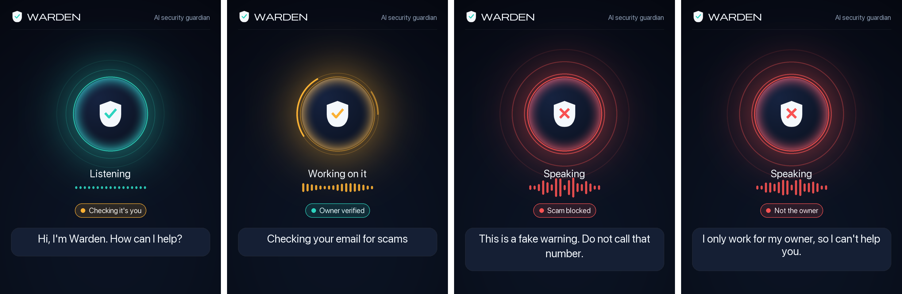

# Warden

A FaceTime security guardian for people who can't safely navigate the internet on their own.

They call Warden (a [Chert](https://www.trychert.com) FaceTime line) and say what they want: "check my email", "order a pizza", "is this letter a scam?". A cloud-style browser does it for them, while a security layer inspects every page and every action. Warden refuses to sign in on look-alike sites, refuses gift-card and wire requests, ignores instructions hidden in emails, and needs a spoken yes **plus a press of an approve button** before it spends, sends, deletes or changes security settings.

Pitch: *Scammers target people who can't see the warning signs. Warden sees them for you, and only for you.*

Only the enrolled owner can use it: the caller's **face and voice must both match** before any tool will run.



See [USE_CASES.md](USE_CASES.md) for who it helps and the ten situations it handles, and [DEMO.md](DEMO.md) for a three-minute demo script.

## How it fits together

```
FaceTime ─▶ Chert line ─▶ LiveKit room ◀─ agent/agent.py (voice: speech-to-text → Grok → text-to-speech)
                                              │ HTTP
                                              ▼
dashboard + approve button ◀──────────▶ orchestrator (tasks, safety gate, scam guard, audit, vault)
                                              │
                                              ▼
                                   worker (Playwright browser, planned by Grok) ─▶ websites
```

- **Voice and browsing both use Grok** (`xai/grok-4.3`) through LiveKit Inference, so the only keys are your LiveKit project's. Reading a letter on camera uses `google/gemini-3.8-flash` through the same gateway, because Grok rejected image input there. `LEND_PLANNER=claude` switches browsing to a local Claude Code login.
- **The safety rules are plain code**, not model behaviour. `make redteam` proves it with scripted attackers and no AI at all.

## Setup

```bash
make setup        # .venv, deps, Chromium, .env, encrypted vault with the mock-site test logins
make test         # 61 tests
make redteam      # 12 attack scenarios, no keys needed
```

For anything that talks (the harness or a real call), put your LiveKit Cloud project's values in `.env.local`:

```
LIVEKIT_URL=wss://<project>.livekit.cloud
LIVEKIT_API_KEY=...
LIVEKIT_API_SECRET=...
AGENT_NAME=<a name no other team uses>
```

## Run

| Command | What it runs |
| --- | --- |
| `make demo` | Mock sites + orchestrator + dashboard + approve-button page + text harness. No Chert, no hardware. |
| `make mocks` | Mock bank, mail, pizza and four scam sites on :8100 (admin and **Inject fraud** at http://localhost:8100) |
| `make orchestrator` | Task API, safety gate, dashboard at http://127.0.0.1:8200, approve button at `/button` |
| `make harness` | Talk to Warden by typing. Same tools as the call. `--no-llm` for keyword mode. |
| `make agent` + `make chert` | The real FaceTime line (also needs `make mocks` and `make orchestrator`) |
| `make worker GOAL="read my inbox"` | One goal straight through the worker, without the orchestrator |
| `make redteam` | Scam scorecard (used by the Grok Bot automation, see `GROK_BOT.md`) |

## Safety model

**Tiers** (`orchestrator/policy.py`), decided before every browser action:

| Tier | Actions | Needs |
| --- | --- | --- |
| 0 | read, navigate, type a draft | nothing |
| 1 | reversible changes (add to cart) | the caller's spoken request on the call |
| 2 | money, send, delete, card freeze, sign out devices | spoken yes **and** approve-button press (or caregiver approval) within 60 s, under the spending limit; caregiver notified |
| 3 | typing passwords, codes, card or account numbers; changing recovery info; new payees; gift cards, wires, crypto | never |

Sites outside the safe list open **look-only**: the guard inspects them, and nothing can be clicked or typed.

**Scam guard** (`orchestrator/guard.py`) runs on every page load before the model sees the page: look-alike and homoglyph domains, punycode, brand/host mismatch, login forms on origins with no saved login, fake-support phone numbers, gift card / crypto / wire requests, requests for codes or passwords, urgency, link text that doesn't match its address, and text aimed at AI assistants. A dangerous page ends the task, is closed, and the caregiver is told.

**Credentials** live in an encrypted vault (`data/vault.enc`, key in `.env`). A login is filled by Playwright only on the exact origin it was saved for. The model never sees it, and the gate blocks typing into password fields.

**Untrusted content**: page and email text reaches the model only inside `<untrusted_page_content>` blocks. Even a fully compromised planner can't forward or delete mail, because those actions need the person's approval (tested).

**Owner check** (`agent/verify.py`): on a FaceTime Video call the caller's face (OpenCV YuNet + SFace) and voice (WeSpeaker speaker embedding) are compared with the enrolled owner, about once a second, on this computer. Until both match, every tool except "stop" is refused in code, and a mismatch alerts the caregiver. `make models` downloads the models; `make enroll` makes the next call an enrollment call. Only numeric embeddings are stored (`data/owner/`), never photos or recordings. It matches identity, not liveness: a good photo or recording could fool it, so it sits on top of the approval rules instead of replacing them. `LEND_VERIFY=off` disables it.

**Tamper-evident log on Solana** (`orchestrator/chain.py`): an AI that touches your money should not be able to rewrite its own history. Every action-log entry is fingerprinted into a hash chain, and every few seconds the newest fingerprint is written to Solana (devnet) in a Memo transaction, so one transaction of 0.000005 SOL commits to the whole log so far. The dashboard links each entry to its transaction, and **Verify log** recomputes the chain and compares it with Solana; a changed or deleted entry is reported by number. Only fingerprints go on chain, never emails, amounts or names. `make solana` creates the wallet. If Solana is unreachable Warden keeps working and entries show as pending.

**Approve button**: a big on-screen button at `/button` (keyboard: Space or Enter).

**Safety box (optional hardware)**: an Arduino Uno with a button, a rotary knob and a light (`hardware/`, `make box`, or `make box-sim` with no board). The button approves what Warden is waiting on; pressed at any other time it locks everything for 30 minutes, alerts the caregiver and starts an account check, and only the caregiver can clear it. The knob can lower the spending limit, never raise it. The sketch has only been run in the simulator, not on a board.

**Account watch** (`orchestrator/audit.py`): reads bank transactions, sign-ins and the inbox, then flags small test charges followed by a large one, new merchants, amounts far above the usual (median/MAD), duplicates, new-device sign-ins, security notices and phishing emails. Wording is always "looks unusual, did you make this?". Set `AUDIT_INTERVAL_S` to run it on a timer.

## Environment

See `.env.example`. `.env`, `.env.local` and `data/` are gitignored. Mock-site logins are fake and work nowhere else.

| Variable | Meaning |
| --- | --- |
| `LEND_PLANNER` | `grok` (default) or `claude` |
| `LEND_GROK_MODEL`, `LEND_VOICE_LLM`, `LEND_VISION_MODEL` | model IDs on LiveKit Inference |
| `CHERT_MODE` | `mock` (default) or `live` |
| `CHERT_API_KEY`, `CHERT_PROJECT_ID`, `CHERT_LINE_ID` | for live iMessage and outbound calls |
| `USER_PHONE`, `CAREGIVER_PHONE` | numbers verified on your Chert project |
| `AUDIT_INTERVAL_S` | seconds between automatic account checks (0 = off) |

## Chert TODOs

Everything Chert-specific is in `agent/chert_adapter.py`.

1. `TODO(chert)` **iMessage images**: the trial `shared-messages` API documents text only, so enlarged screenshots are sent in mock mode only. Live, Warden says it can't send the picture.
2. `TODO(chert)` **show_on_call**: no documented way to show an image mid-call. Falls back to `send_imessage`.
3. `TODO(chert)` **Outbound callback**: written from [the outbound docs](https://docs.trychert.com/facetime/outbound) (agent dispatch, bridge token, `POST /calls`, wait for `bridge_ready`) but **not yet verified on a real line**. It needs a project API key.
4. `TODO(chert)` **Caller camera**: `read_paper` uses the caller's video track when the line has caller capture enabled. Not verified on this line; without a track it asks the person to read the letter aloud.

## What is verified, and what isn't

- **Verified:** mock sites, worker (Grok and Claude), safety tiers, scam guard, approvals, audit, dashboard, approve button, text harness with Grok, scam-letter reading from a fixture image, the agent registering and joining Chert's test room.
- **Not verified:** a full spoken FaceTime call through the new tools, live outbound callback, live iMessage, caller camera frames.

## Known limits

- Chert trial and Shared calls are capped at 5 minutes. Tasks keep running in the orchestrator after a call ends.
- The laptop must stay on: the agent, orchestrator and browser run on it.
- Browser agents are slow and sometimes wrong. Scripted skills cover the demo paths; step and time limits stop runaways.
- Real banks block automated browsers and need 2FA. Warden is demoed on mock sites and never touches real money.
- Fraud scoring and look-alike detection have false positives (for example, a new shop you really used, or a domain that happens to contain a brand name).
- The dashboard has no login. It listens on this computer only.
- Spend baselines use SQLite. The optional Tiger Data hypertable is not built.
